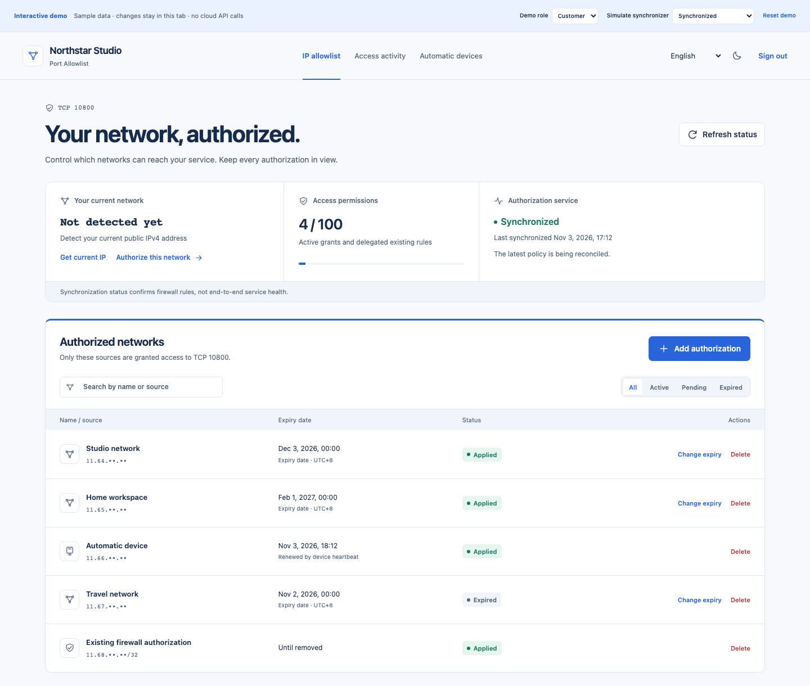

# Port Allowlist

**A self-service IP allowlist for one Alibaba Cloud TCP service.**

[English](README.md) · [简体中文](README.zh-CN.md) · [Documentation](https://kongdayan.github.io/port-allowlist/en/) · [Interactive demo](https://kongdayan.github.io/port-allowlist/demo/)

Give customers one login token and a dedicated portal. They can authorize their current network, choose an expiry date, renew or remove access, and connect an automatic updater. Cloudflare hosts the portal; Alibaba credentials stay on ECS. Business traffic goes directly to your service.



## Try it in a minute

Node.js **22.23.4+** and npm are required. `npm ci` also installs the documentation dependencies; no cloud credentials are needed.

```sh
git clone https://github.com/kongdayan/port-allowlist.git
cd port-allowlist
npm ci
npm run demo
```

Open the URL printed by Vite. Add, renew and delete sample grants; switch language, appearance, customer/operator role and synchronization state. The demo is isolated in browser memory and never calls cloud APIs. Reload or reset discards changes.

For a real local API with persistent SQLite storage:

```sh
npm run setup
npm run dev
# In a second terminal:
npm run bootstrap
```

Operator: `http://localhost:8798`, using `admin` from `.local/credentials.json`. Customer: `http://client.localhost:8798`, using `key` from `.local/client.json`. Inspect these files locally; setup never prints tokens. No ECS agent means synchronization is pending, without fabricated traffic.

## What v0.2 includes

- A responsive authorization-first UI, complete English / Simplified Chinese and light/dark appearance.
- Current-IP detection and a prefilled authorization form; date/day presets with explicit business-zone midnight expiry (UTC+8 by default).
- Distinct submitted, synchronizing, applied, removing and failure states; forms and expanded sessions survive polling.
- Customer-scoped views, operator quotas, one-time device tokens and platform updater scripts.
- Actual socket-based connection / transfer samples, grouped session activity and logical access diagrams.
- An ECS-local Python synchronizer: dry-run first, add-before-delete verification and explicit rule ownership.
- Bilingual Starlight documentation, a public interactive demo and stable, localized API error codes.

## Deploy your own

[Follow the deployment guide](https://kongdayan.github.io/port-allowlist/en/deployment/) to configure two Cloudflare custom hostnames, deploy the Worker and SQLite Durable Object, then install the restricted ECS agent. Alibaba API keys never go to Cloudflare or the customer browser. Installation previews changes and does not start the agent or modify SSH, Nginx or Docker.

| Component                             | Support in v0.2                                               |
| ------------------------------------- | ------------------------------------------------------------- |
| Firewall provider                     | Alibaba Cloud ECS security groups                             |
| Scope                                 | One security group and one configured TCP port per deployment |
| Sources                               | Exact public IPv4 grants                                      |
| Control plane                         | Cloudflare Workers + SQLite Durable Objects                   |
| Other clouds / Terraform / IPv6 / UDP | Not included                                                  |

Use your own cloud accounts; provider permissions, charges and quotas apply. Synchronizer outages do not automatically expire existing cloud rules. Revocation may leave established TCP connections alive. Windows scheduled-task runtime acceptance remains pending. Read the [security model](https://kongdayan.github.io/port-allowlist/en/security/) before production use.

## Development

```sh
npm run build
npm run check
npm test
npm run test:agent
npm run check:content
npm run build:site
npx playwright install chromium
npm run test:browser
npm run test:site
npm run audit:public
```

Python 3.10+ is needed for agent tests. The public audit scans staged source; run it after deliberately staging intended files. `npm run docs:dev` starts documentation; `npm run build:site` builds docs plus the demo in `site-dist/` for static hosting. GitHub Pages publication contains no Worker backend or credentials.

[Customer guide](https://kongdayan.github.io/port-allowlist/en/customer-guide/) · [Device setup](https://kongdayan.github.io/port-allowlist/en/devices/) · [Upgrade from v0.1](https://kongdayan.github.io/port-allowlist/en/upgrade/) · [API](https://kongdayan.github.io/port-allowlist/en/api/) · [Contributing](CONTRIBUTING.md)

MIT licensed. Keep real tokens, source addresses, customer data and deployment files out of Git and public issues.
