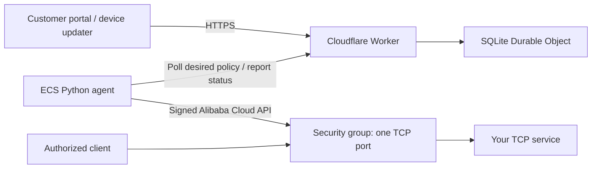

# Port Allowlist

**A self-service portal for a single TCP port, backed by Cloudflare and an ECS-local Alibaba Cloud security-group agent.**

[中文文档](README.zh-CN.md) · [Deployment](docs/deployment.md) · [Security model](docs/security.md) · [API](docs/api.md)

Give a customer one login token and their own hostname. They can add, renew, and remove authorized public egress addresses, install an automatic IP updater, and see connection activity. Cloud credentials stay on ECS; business traffic goes directly to your server.



## Try locally

Requirements: Node.js 22.18+ (tested on 22.23.3), Python 3.10+ for agent tests. No cloud credentials are needed for this local flow.

```sh
git clone https://github.com/kongdayan/port-allowlist.git
cd port-allowlist
npm ci
npm run setup
npm run dev
```

In another terminal:

```sh
npm run bootstrap
```

- Operator: `http://localhost:8798`; read the `admin` field in `.local/credentials.json` locally.
- Customer: `http://client.localhost:8798`; read the `key` field in `.local/client.json` locally.
- The customer starts with 100 IP authorizations and 10 automatic devices. These are operator-controlled quotas.
- No ECS agent is installed in this local flow: synchronization is shown as pending, with no fabricated traffic. The portal does not open local firewall ports.

Secrets are generated randomly, saved with owner-only permissions, and never printed. Re-running setup preserves them. The UI currently uses Simplified Chinese; code and operational documentation are in English.

## Features

- Separate operator and customer hostnames with server-side tenant authorization.
- One customer login token; separate limited device tokens for automatic updates.
- Manual grants: default 30 calendar days, optional expiry date, renewal, UTC+8 midnight expiry.
- Automatic grants: default 60-minute lease; macOS / Linux script and Windows PowerShell updater.
- Tenant quotas up to 100 grants; deployment-wide ceiling of 180 distinct active addresses including migration grace periods.
- Add new rules and verify provider visibility before removing old managed rules.
- Dry-run first. A pinned port, signed rule fingerprints, explicit ownership, and limited cloud actions protect unrelated rules.
- Existing rules can be deleted only after explicit operator delegation and a specific customer deletion request.
- Real socket counters, connection history, source graph and architecture view; no simulated health signals.
- SQLite persistence, audit trail, session cookies, CSRF checks, rate limiting, bounded requests.

## Deploy your own

Use your own Cloudflare account and two custom hostnames in a Cloudflare-managed zone:

```sh
npm run setup -- --operator-host access.example.com --client-host team.example.com --brand 'Your Network' --port 10800
npx cf auth login
npm run deploy -- --dry-run
npm run deploy
npm run bootstrap -- --url https://access.example.com --client-host team.example.com --name 'Your Team'
```

The ECS agent must use the same port. Follow [the ECS installation and validation guide](docs/deployment.md) before enabling writes. No automatic production deployment is configured in GitHub Actions.

Deployment requires Cloudflare Workers / SQLite Durable Objects and an Alibaba Cloud ECS security group. Account permissions, quotas and provider charges apply; this repository does not promise a free production deployment. [Cloudflare pricing](https://developers.cloudflare.com/durable-objects/platform/pricing/).

## Verify

```sh
npm run build
npm run check
npm test
npm run test:agent
npx playwright install chromium
npm run test:browser
npm run audit:public
```

The browser test starts an isolated local server and provisions temporary, synthetic test data. The public audit scans tracked files for credential patterns, literal IP addresses, local user paths and cloud resource identifiers. Use a separate secret scanner and human review before publishing a customized fork.

## Scope

One deployment manages one security group and one TCP port. The provider is Alibaba Cloud ECS; other providers need an adapter. Customer management supports multiple tenants, but legacy-rule ownership is exclusive to one tenant for the selected port. IPv6 and UDP are not managed. This is a network allowlist, not a proxy or a replacement for service authentication.

[Security boundaries and failure behavior](docs/security.md) · [Configuration and installation](docs/deployment.md) · [Contributing](CONTRIBUTING.md)

MIT licensed.
