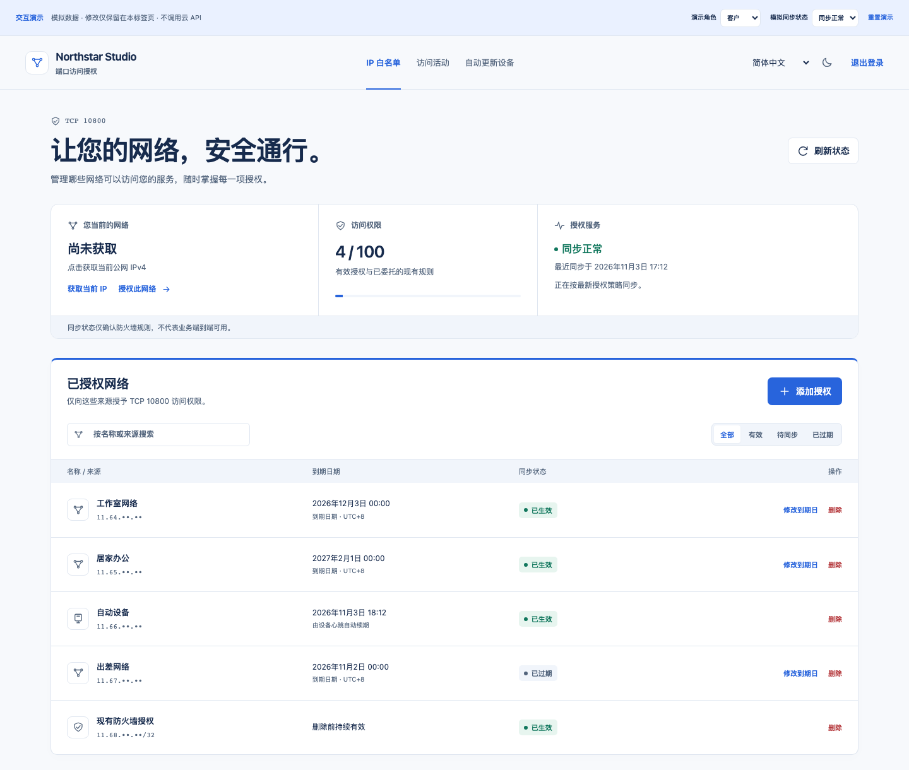

# Port Allowlist · 端口访问授权

**面向客户的阿里云单端口 IP 自助白名单。**

[English](README.md) · [简体中文](README.zh-CN.md) · [使用文档](https://kongdayan.github.io/port-allowlist/zh-cn/) · [交互演示](https://kongdayan.github.io/port-allowlist/demo/?lang=zh-CN)

给客户一个专属入口和登录令牌，就能授权当前网络、选择到期日期、续期或删除访问，以及连接自动更新设备。网页由 Cloudflare 托管，阿里云凭据只留在 ECS；业务流量直接进入您的服务。



## 一分钟体验

需要 Node.js **22.23.4+** 和 npm。`npm ci` 会同时安装文档站依赖，无需任何云凭据。

```sh
git clone https://github.com/kongdayan/port-allowlist.git
cd port-allowlist
npm ci
npm run demo
```

打开 Vite 输出的地址，即可添加、续期、删除模拟授权，切换语言、外观、客户 / 管理员角色和同步状态。演示独立运行在浏览器内存中，不调用云 API；刷新或重置后清空改动。

如需体验真实 API 与 SQLite 持久存储：

```sh
npm run setup
npm run dev
# 在第二个终端中执行：
npm run bootstrap
```

管理员入口 `http://localhost:8798`，令牌为 `.local/credentials.json` 的 `admin`；客户入口 `http://client.localhost:8798`，令牌为 `.local/client.json` 的 `key`。请只在本机查看，初始化不会打印密钥。未连接 ECS Agent 时如实显示等待同步，不伪造流量。

## v0.2 包含什么

- 以授权管理为主的响应式 UI、完整英文 / 简体中文与浅色 / 深色外观。
- 获取当前 IP 并预填表单；天数与日期联动，明确提示业务时区零点失效（默认 UTC+8）。
- 区分已提交、正在同步、已生效、删除中和同步失败；自动刷新保留表单与展开会话。
- 客户范围隔离、管理员配额配置、一次性设备密钥与多平台更新脚本。
- 真实 socket 连接 / 字节差分采样、按来源归并的会话活动与逻辑节点图。
- ECS 本地 Python 同步器：默认预览，先添加确认再删除，明确限定规则归属。
- 中英 Starlight 文档站、公开交互演示与稳定可翻译的 API 错误码。

## 部署自己的服务

按[部署指南](https://kongdayan.github.io/port-allowlist/zh-cn/deployment/)配置两个 Cloudflare 自定义域名，部署 Worker 与 SQLite Durable Object，再安装受限 ECS Agent。阿里云密钥不会进入 Cloudflare 或客户浏览器。安装器先预览，不自动启动 Agent，也不改动 SSH、Nginx 或 Docker。

| 组件                            | v0.2 支持范围                               |
| ------------------------------- | ------------------------------------------- |
| 防火墙提供商                    | 阿里云 ECS 安全组                           |
| 管理范围                        | 每部署一个安全组、一个配置好的 TCP 端口     |
| 来源                            | 精确公网 IPv4 授权                          |
| 控制面                          | Cloudflare Workers + SQLite Durable Objects |
| 其他云 / Terraform / IPv6 / UDP | 本版不包含                                  |

需使用自己的云账号，权限、费用和配额以提供商实际配置为准。同步器中断时，已下发的云规则不会自行到期；撤销规则也可能保留已有 TCP 连接。Windows 计划任务实机验收仍待完成，生产使用前请阅读[安全边界](https://kongdayan.github.io/port-allowlist/zh-cn/security/)。

## 开发与验证

```sh
npm run build
npm run check
npm test
npm run test:agent
npm run check:content
npm run build:site
npx playwright install chromium
npm run test:browser
npm run test:site
npm run audit:public
```

Agent 测试需要 Python 3.10+。公开扫描检查暂存源码，应先明确暂存需要发布的文件。`npm run docs:dev` 启动文档站，`npm run build:site` 将文档和演示组装到 `site-dist/`；GitHub Pages 发布物不包含 Worker 后端或凭据。

[客户指南](https://kongdayan.github.io/port-allowlist/zh-cn/customer-guide/) · [设备安装](https://kongdayan.github.io/port-allowlist/zh-cn/devices/) · [从 v0.1 升级](https://kongdayan.github.io/port-allowlist/zh-cn/upgrade/) · [API](https://kongdayan.github.io/port-allowlist/zh-cn/api/) · [参与贡献](CONTRIBUTING.md)

采用 MIT 许可证。真实令牌、来源地址、客户资料和部署配置不得进入 Git 或公开 Issue。
